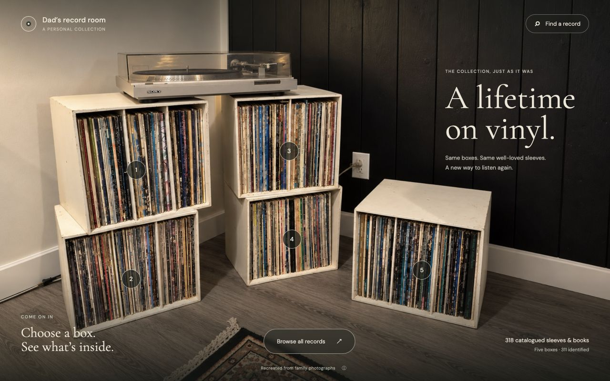
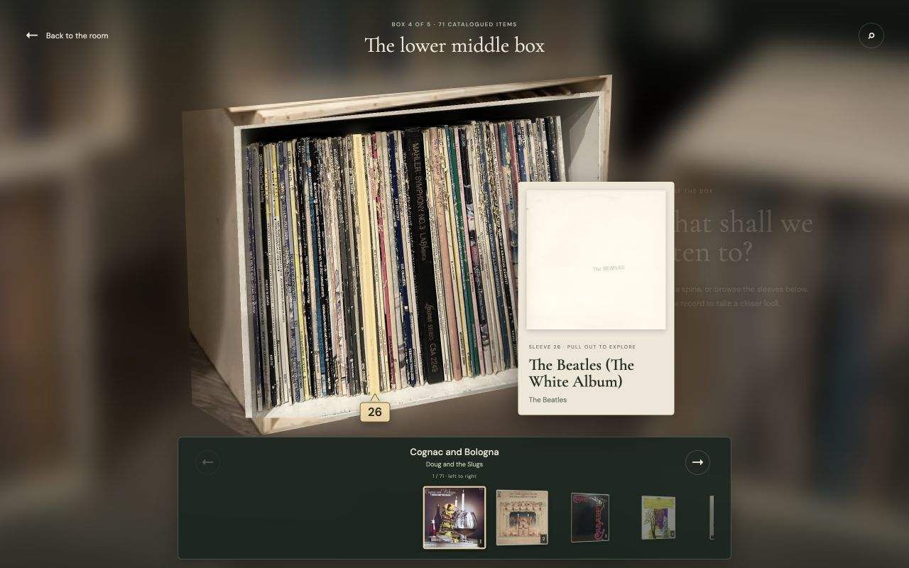
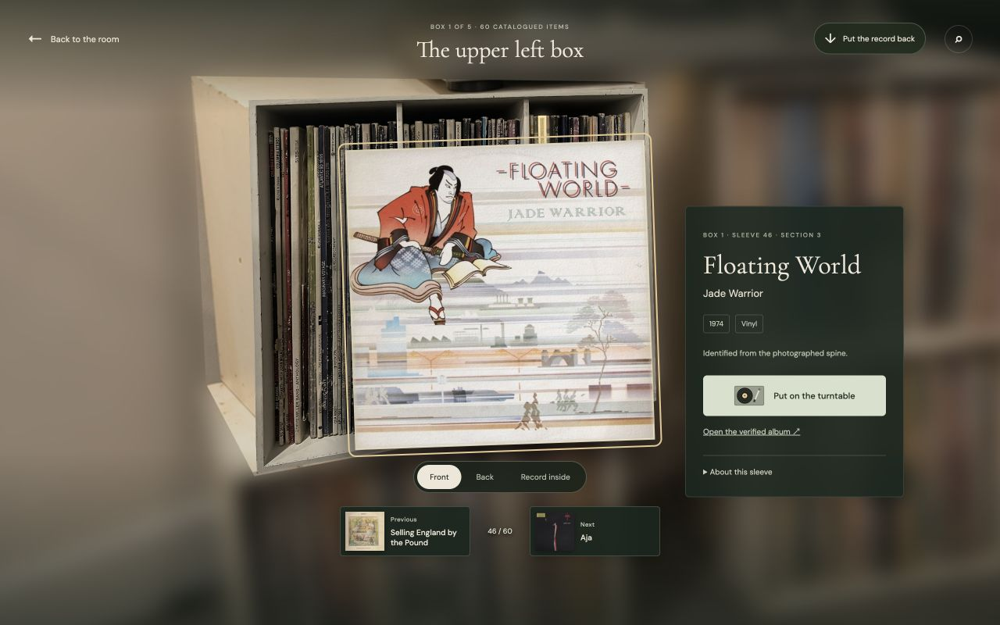
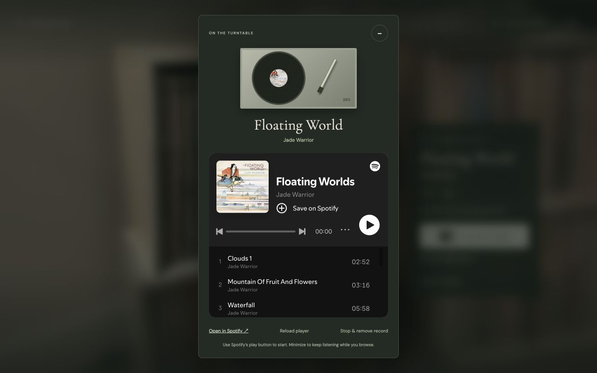
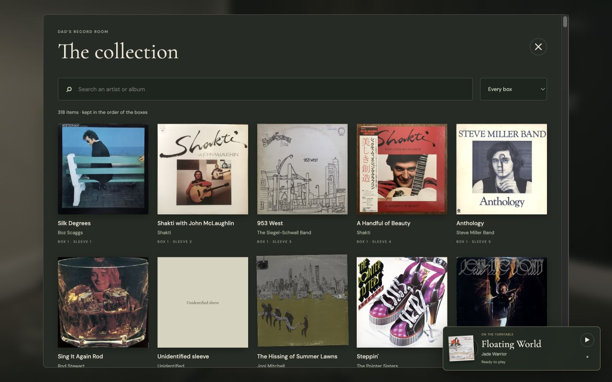

# Dad’s record room

A lifetime on vinyl, kept in the boxes it came from.

This is an interactive home for my dad’s record collection, made from photographs of the room where it lives. Walk up to a box, follow a worn spine, pull out a sleeve, and put an album on the turntable.

**[Step into the record room →](https://records.zittlau.ca/)**



There are **five boxes and 318 catalogued items**, including a well-loved art book. So far, **311 have been identified**, and 283 have verified Spotify album links. Everything stays in the order of the physical collection, including duplicate copies and the occasional sleeve we still can’t read.

## Look into a box

Choose a box and the room moves closer. The surroundings soften into a blur, while the box comes into focus. You’re still in the same room, looking into the same box.

The extra detail comes from the original close-up photograph of that box. It is fitted into the room’s perspective as you approach, so you can see the real creases, faded lettering, and uneven edges of the sleeves.



Move over a spine to see its cover and number. Each clickable outline follows the photographed record: leaning sleeves lean, wide sets stay wide, and bent edges have their own shape. The highlight sits on the sleeve itself. Click or tap it to pull the record out; the cover carousel gives you another way to find it.

## Pull out a record

The sleeve opens in front of its box, with room to inspect the artwork. Turn it over, look at the illustrated record inside, or use the neighboring covers to move to the next album. The selected spine stays highlighted behind it, so you can see where it belongs.



Click the background to put the record back. Click the background again from the box view to return to the room. On a phone, tap to select and swipe through the covers; on a keyboard, use Tab, Enter, and the arrow keys.

## Put something on

Choose **Put on the turntable** to open the album in Spotify’s own player, inside a turntable view. Use Spotify’s play button to begin. Minimize the turntable and it becomes a small corner player while you keep exploring; the same player stays loaded.



Verified links point to specific albums, with the artist and recording checked. If a match is still uncertain, the collection offers a clearly labeled Spotify search instead.

The website doesn’t ask you to connect a separate Spotify developer app. Spotify handles its own sign-in and playback. Full listening or previews depend on Spotify’s session, browser support, and availability; the exact album also opens directly in Spotify. See [Spotify’s embed troubleshooting guide](https://developer.spotify.com/documentation/embeds/tutorials/troubleshooting) if the widget only plays previews.

## Browse another way

**Browse all records** opens a cover gallery. Search by artist or album, or filter to a particular box. Every result keeps its box and sleeve number, and opens back in its place in the room.



## Filling in the collection

The catalogue grew from reading the spines, comparing cover scans and release information, and checking the family’s own photographs. A [phone capture guide](https://records.zittlau.ca/capture.html) made the difficult cases easier: it shows where to find each sleeve, then asks for its front and back in sequence. There’s no need to name or organize the photos afterward.

That first capture round has already supplied **90 photos of 45 items**. The saved guide preserves that original sequence so the uploads can always be matched to the right records. Seven thin or uncertain edges still need identification; they keep honest placeholders rather than invented album names.

## What you’re looking at

- **The room overview is an AI-generated reconstruction**, built from six family photographs. The detailed box views use the actual family photographs, projected into that room.
- **The shelves keep their character.** Scuffs, tilted sleeves, divider gaps, and physical order come from the source photos.
- **The covers are researched artwork.** Cleaner published scans are preferred where available. Some show another pressing or a digital edition; differences and sources are recorded in the sleeve details. A few scarce images come from the family’s own photos.
- **The loose vinyl is an illustration.** Some discs have sourced labels from representative editions; they are not photographs of the family’s individual discs.

---

## How it works — technical details

The app uses plain JavaScript, CSS, and SVG. There is no application framework, bundler, or 3D engine. The depth comes from carefully aligned photographic layers and a shared camera transform.

### A sharper photograph in the same perspective

Each box has an original **4032 × 3024** source photograph. Four measured corners on that photo correspond to four corners of the box in the room overview. A **projective homography** calculates how to fit one quadrilateral onto the other, including its perspective.

[photo-projection.js](site/dist/photo-projection.js) solves that mapping and converts it to a CSS `matrix3d`. As the camera approaches a box, the full-resolution photo blends into its matching position. The overview, focused photo, and interactive spine layer all move with the same camera transform, keeping the transition aligned.

Calibration lives in [photo-calibration.json](site/research/photo-calibration.json), with browser-ready coordinates in [box-photos.json](site/dist/box-photos.json). A small corner of the lower-middle box falls outside its source photograph; the overview remains underneath that gap.

### Masks that follow the records

Spine masks are polygons traced in the source photograph’s coordinate system and rendered as SVG paths. Multiple vertices follow leaning and worn sleeves rather than dividing the box into equal rectangles. [spine-masks.js](site/dist/spine-masks.js) projects those polygons through **the same homography as the photograph**, so the image, clickable area, and selected highlight agree.

The number marker follows the sleeve’s lower edge. Polygons are clipped to the real image bounds, and divider gaps stay outside the record outlines. Some unreadable boundaries remain estimates between clearer anchors; a precise-looking outline does not imply a confirmed album identity.

### A catalogue with evidence

The editable catalogue records each item’s box, physical position, spine transcription, identification confidence, artwork provenance, and listening sources. Stable IDs preserve direct links as research improves. There are 320 stable source positions: two folded sleeve edges resolve to their parent albums, leaving 318 catalogued items.

Classical Spotify matches check the performers and recording, alongside the work’s title. Remasters and expanded releases can be linked when the original album programme is verified; edition differences stay documented. The 283 linked items use 281 distinct Spotify album IDs, because physical copies can share a listening edition.

The [research report](site/research/deep-research-report.md), [capture intake](site/research/capture-intake-2026-10-14/README.md), and per-item sources retain the reasoning behind those decisions.

### A player that stays with you

[turntable.js](site/dist/turntable.js) keeps Spotify’s embedded player mounted when the turntable is minimized. It observes playback state and can pause it; starting playback stays with Spotify’s own controls. Browsing a different box or inspecting another sleeve does not replace the playing album. Loading a different album, reloading the player, or removing the record does.

Normal browsing needs no Spotify API credentials or custom OAuth flow. Older account-player tools remain in the repository for development and callback recovery; they are described in the [maintainer documentation](site/README.md#optional-legacy-spotify-tools).

## Run it locally

Install **Node.js** and **Python 3.9 or newer**, then run:

```sh
git clone https://github.com/benzittlau/record-collection.git
cd record-collection
npm run dev
```

Open **[http://127.0.0.1:4173/](http://127.0.0.1:4173/)**. There are no npm dependencies to install, no build step, and no account configuration required to browse the collection or load Spotify’s widget. Cloning requires access while the repository is private.

Run the project checks with:

```sh
npm run check
```

These cover syntax, catalogue consistency, photo projection, spine geometry, source checksums, cache keys, the saved capture sequence, and Spotify configuration and link evidence.

## Working on the archive

| Where | What it contains |
| --- | --- |
| [site/dist/](site/dist/) | The website, generated catalogue, photos, covers, and player. |
| [site/research/](site/research/) | Editable catalogue, traced spine masks, calibration, sources, and research reviews. |
| [site/scripts/](site/scripts/) | Catalogue merges, photo preparation, capture matching, and validation tools. |
| [reference/](reference/) and the root `IMG_3568.HEIC`–`IMG_3573.HEIC` files | Original photographic references, with location and capture metadata removed. |
| [visuals/](visuals/) | Room renderings, generation prompts, and earlier visual reviews. |
| [docs/screenshots/](docs/screenshots/) | Screenshots in this README, captured in Codex’s built-in browser. |

After editing the catalogue or traced masks, regenerate the website data from the repository root:

```sh
node site/scripts/merge-catalog.mjs
node site/scripts/merge-spine-masks.mjs
npm run check
```

Keep item IDs and the completed photo guide’s frozen sequence stable. See [the maintainer documentation](site/README.md) for the full editing workflow, capture reconciliation, source limitations, and deployment commands.

## Hosting and private files

The public website runs on Vercel at **[records.zittlau.ca](https://records.zittlau.ca/)**. Its static files live in `site/dist/`; deployment uses the Vercel CLI. The separate, older Sites publishing checkout lives in the ignored `.sites-publish/` directory. Preserve its Git metadata and private audience when maintaining it.

Local environment files and raw phone-photo intake are ignored by Git and excluded from deployment. Committed family references have been stripped of location and capture metadata while preserving their image pixels, orientation, and colour information. Keep future credentials in local or hosting environment storage, outside tracked files.
